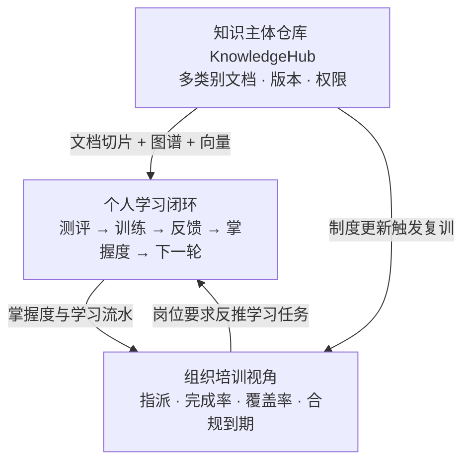
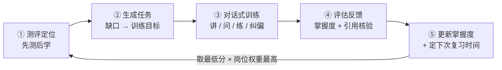

# 企业级知识学习与培训平台改造方案（最小改动版）

> 版本：v1
> 日期：2026-11-08
> 适用仓库：AgentCareer（Spring Boot 3.3.5 / Java 21 / MyBatis-Plus / LangChain4j 0.30 / MySQL + pgvector / Redis / RabbitMQ）
> 目标：把“AI 模拟面试系统”改造成“企业知识学习与培训平台”，且不在既有架构上推倒重来。
> 状态：设计文档，尚未改动代码。

---

## 0. 一句话结论

这套代码不需要“重建”，只需要“换油”：**把题目来源从“通用技术简历”换成“企业知识主体仓库”，把评分口径从“面试表现”换成“掌握度”，把对象从“一个人”扩展成“一个人 + 一个组织 + 一批文档”。**

车架——编排（orchestrator）、检索（Hybrid/GraphRAG）、记忆（三层）、治理（PromptRuntime/Stage Runtime）、闭环（MQ 后处理 + 闪卡 + 推荐）——一根螺丝都不用动。

具体到改动量：

- 表结构：0 张表重命名，新增 5 张业务表 + 1 张向量表
- 代码：新增约 20 个类，修改约 8 个已有类，删除 0 个
- 配置：换模型 3 行，新增 1 段 `learning.*` 配置
- 前端契约：原有 `/api/interview/**` 全部保留，新增 `/api/repo/**` 与 `/api/training/**`

---

## 1. 为什么这套代码能直接改（现状盘点）

### 1.1 它本质上就是一个“单人多轮训练引擎”

抛开“面试”这个词，系统在做的事情是：

1. 认识一个人（`UserProfile` + 简历/项目文本）
2. 围绕一个主题发起提问（`TechInterviewerAgent`）
3. 用户作答后打分（`ScoreAgent` → `ScoringStage`）
4. 判断该追问、该换题、还是该加难（`DifficultyPolicy` + `MemoryDecisionService` + `GraphDecisionService` → `DecisionAggregator`）
5. 作答时去查资料（`RetrievalPlanningService` → `HybridRetriever` → GraphRAG）
6. 结束后提炼知识点、更新画像、写长期记忆、生成闪卡、建图谱、更新社区报告（MQ 异步后处理）
7. 平时给推荐和复习计划（Dashboard + Flashcard + LearningRecommendation）

**这套流程和“企业培训”的流程是同构的。**企业培训要做的也是：认识一个员工 → 围绕一个岗位能力/知识点发起训练 → 员工作答 → 评估掌握度 → 决定是讲解、追问、加练还是收尾 → 查企业知识库作答 → 结束后沉淀掌握度、生成复习卡、更新能力画像。差别只在“资料从哪来”和“分数怎么算”。

### 1.2 可以直接复用、一行不改的部分

- `com.ai.orchestrator.AgentOrchestrator`：多 Agent 决策中控，7 个阶段顺序 + 并发决策 + 聚合，培训场景原样可用
- `com.ai.orchestrator.runtime.*`：`PipelineStageExecutor`、`StageRecoveryPolicy`、`StageRecoveryResult`——阶段级失败降级，这是企业系统最需要的“不整体崩”
- `com.ai.orchestrator.pipeline.*`：`RetrievalPlanningStage`、`GraphRagEnrichmentStage`、`PromptAssemblyStage`
- `com.service.garphrag.*`：GraphRAG 全链路——`GraphRagIndexerService`、`GraphCommunityService`、Local/Global/DRIFT/Vector/Memory 五种检索策略、`GraphRagQueryClassifier`
- `com.service.admin.TracePersistenceService` + `entity.Trace.TraceEvent`：追加式轨迹
- `com.dto.mq.InterviewPostProcessConsumer`：状态机（PENDING/PROCESSING/SUCCESS/FAILED）+ 重试 3 次 + 死信队列，这套“异步后处理骨架”直接复制给“文档摄取”
- `com.service.Dashboard.FlashcardService` / `DashboardService` / `LearningRecommendationService`：学习看板与推荐
- `com.service.cache.*`：`AiRateLimitService`、`AiQueryCacheService`、`InterviewMemoryCacheService`
- `com.ai.guard.*`：输出守卫（培训场景要扩成“引用守卫”）
- `src/test/java/com/benchmark` + `src/main/resources/data/**`：现成的评测数据集与基准框架

### 1.3 改语义就能用、不用改结构的部分

- `PromptBuilder`：13 个 `buildXxxPrompt`，换文案模板即可（题库风格、评分口径、提炼口径）
- `DefaultPromptBudgetAllocator`：预算分配逻辑留着，改成第七章说的“Inline & Spill”
- `HybridRetriever`：检索流程留着，加“检索范围（组织/仓库/文档）”参数
- `MemoryLayerRouterService`：记忆分层路由留着，第三层从“个人面试史”换成“个人学习史”
- `DecisionAction`：`FOLLOW_UP / NEXT / HARDER / FINISH` 四个动作，培训场景只需再加 3 个

### 1.4 必须换掉、不能凑合的部分

- `InterviewService` 的“面试”语义（开始/作答/结束三段式状态机）；建议不动原类，抽一个 `LearningSessionService` 复用它的会话/消息/限流/缓存逻辑
- `PromptBuilder` 里所有“面试官”“候选人”“下一题”的话术
- `ScoringStage` 的评分维度（技术/完整度/表达），企业培训要换成掌握度维度
- `ProfileMergeService` 的抽取口径（简历/项目 → 岗位/能力项）
- 所有 prompt 里的“请结合你的项目经验展开”——培训场景不能这么问

### 1.5 现状里本来就缺的两块地基（顺手补上，否则企业版跑不起来）

**第一，权限是裸奔的。**现在所有接口都是 `@RequestParam Long userId`，没有任何鉴权，也没有组织概念。企业版一条“谁能看哪份制度”就能让这套东西不能上线。P0 必须先补一个最小上下文（后文 8.1）。

**第二，数据库没有 baseline schema。**`src/main/resources/db/migration` 只有两个增量 `ALTER TABLE`，pom 里也没有 Flyway/Liquibase。企业版多环境（开发/测试/生产）必须补一份全量建表脚本 + 迁移工具，否则第二个环境就起不来。这不是改造范围，但是改造的前置条件。

---

## 2. 目标设定：一个仓库 + 一个闭环 + 一个组织视角

### 2.1 三层结构



### 2.2 一句话产品定义

**以企业知识主体仓库为唯一事实来源，用对话式训练帮每个员工把“文档里的内容”变成“能说清、能做对、能合规执行”的能力，并把每一次训练的结果沉淀成可审计的掌握度。**

三个关键词：

- **唯一事实来源**：所有回答必须有出处，出处是企业文档的某一版某一条，不是模型的世界知识
- **对话式训练**：不是看视频、不是刷题，而是像带教老师一样追问、纠偏、举例、再出题
- **可审计**：谁在什么时候，学了哪一版，掌握到什么程度，全链路留痕

### 2.3 术语对照（面试词 → 培训词）

- 面试 → 训练会话（Learning Session）
- 候选人 → 学习者 / 员工（Learner）
- 简历与项目 → 岗位与能力项（Role & Competency）
- 面试题目 → 训练任务（Training Task）
- 追问 → 引导式追问（Socratic Follow-up）
- 评分 → 掌握度评估（Mastery Assessment）
- 薄弱点 → 能力缺口（Skill Gap）
- 闪卡 → 复习卡（Review Card）
- 面试报告 → 学习报告

改代码时可以直接用这组词做“语义替换清单”，不用改结构。

---

## 3. 核心改造：领域模型

### 3.1 不动的表（一行不改）

`interview_session`、`interview_message`、`user_profile`、`memory_chunk`、`memory_summary_md`、`memory_profile_json`、`flashcard`、`graph_text_unit`、`graph_entity`、`graph_relationship`、`graph_community`、`graph_community_entity`、`graph_community_report`、`user`

理由：它们承载的是“人、会话、消息、记忆、图谱”这些与行业无关的结构。改名要迁移数据、改 Mapper、改前端，收益只有“看起来像培训系统”，不划算。**P0 先用 Java 层适配（`LearningSessionService` 包装 `InterviewService` 的读写），等业务稳定了再考虑物理改名。**

### 3.2 新增 5 张业务表

```sql
-- 1. 知识仓库：企业的“主体仓库”，可按部门/类别拆多个
CREATE TABLE knowledge_repo (
  id            BIGINT PRIMARY KEY AUTO_INCREMENT,
  org_id        BIGINT       NOT NULL,
  name          VARCHAR(128) NOT NULL,
  category      VARCHAR(32)  NOT NULL,  -- POLICY/PRODUCT/TECH/ONBOARDING/COMPLIANCE/SALES
  description   VARCHAR(512),
  owner_user_id BIGINT,
  visibility    VARCHAR(16)  NOT NULL DEFAULT 'ORG',  -- ORG/DEPT/PRIVATE
  status        VARCHAR(16)  NOT NULL DEFAULT 'ACTIVE',
  created_at    DATETIME     NOT NULL DEFAULT CURRENT_TIMESTAMP,
  updated_at    DATETIME     NOT NULL DEFAULT CURRENT_TIMESTAMP ON UPDATE CURRENT_TIMESTAMP,
  KEY idx_org (org_id)
) COMMENT '知识主体仓库';

-- 2. 文档：带版本、带生效期、带密级
CREATE TABLE knowledge_doc (
  id             BIGINT PRIMARY KEY AUTO_INCREMENT,
  repo_id        BIGINT       NOT NULL,
  org_id         BIGINT       NOT NULL,
  title          VARCHAR(256) NOT NULL,
  source_type    VARCHAR(16)  NOT NULL,  -- PDF/DOCX/PPTX/MD/HTML/FAQ/XLSX/VIDEO
  file_url       VARCHAR(512),
  checksum       CHAR(64),              -- 去重 + 变更检测
  version        INT          NOT NULL DEFAULT 1,
  status         VARCHAR(16)  NOT NULL DEFAULT 'DRAFT', -- DRAFT/INDEXING/PUBLISHED/FAILED/ARCHIVED
  effective_date DATE,
  expire_date    DATE,
  security_level TINYINT      NOT NULL DEFAULT 1,      -- 1公开 2内部 3部门 4机密
  tags           JSON,
  chunk_count    INT          NOT NULL DEFAULT 0,
  created_by     BIGINT,
  created_at     DATETIME     NOT NULL DEFAULT CURRENT_TIMESTAMP,
  updated_at     DATETIME     NOT NULL DEFAULT CURRENT_TIMESTAMP ON UPDATE CURRENT_TIMESTAMP,
  UNIQUE KEY uk_repo_title_ver (repo_id, title, version),
  KEY idx_repo_status (repo_id, status)
) COMMENT '知识文档版本';

-- 3. 掌握度：一个人 × 一个概念 × 一个分数
CREATE TABLE learner_mastery (
  id               BIGINT PRIMARY KEY AUTO_INCREMENT,
  user_id          BIGINT       NOT NULL,
  org_id           BIGINT       NOT NULL,
  concept_key      VARCHAR(128) NOT NULL,   -- 归一化后的概念名，关联 graph_entity.name
  concept_name     VARCHAR(128) NOT NULL,
  mastery          TINYINT      NOT NULL DEFAULT 0,   -- 0~100
  confidence       DECIMAL(3,2) NOT NULL DEFAULT 0.00, -- 证据可信度
  evidence_count   INT          NOT NULL DEFAULT 0,
  last_assessed_at DATETIME,
  next_review_at   DATETIME,
  source_doc_ids   JSON,                     -- 支撑该掌握度的文档
  updated_at       DATETIME     NOT NULL DEFAULT CURRENT_TIMESTAMP ON UPDATE CURRENT_TIMESTAMP,
  UNIQUE KEY uk_user_concept (user_id, concept_key),
  KEY idx_user_mastery (user_id, mastery)
) COMMENT '个人概念掌握度';

-- 4. 学习任务：企业培训的“指派”入口
CREATE TABLE learning_task (
  id              BIGINT PRIMARY KEY AUTO_INCREMENT,
  org_id          BIGINT      NOT NULL,
  user_id         BIGINT      NOT NULL,
  repo_id         BIGINT,
  doc_id          BIGINT,
  title           VARCHAR(256) NOT NULL,
  target_concepts JSON,                 -- 目标概念列表
  required        TINYINT     NOT NULL DEFAULT 0,
  due_date        DATE,
  status          VARCHAR(16) NOT NULL DEFAULT 'PENDING', -- PENDING/IN_PROGRESS/DONE/EXPIRED
  session_id      BIGINT,               -- 绑定的训练会话（Router 直通用）
  created_by      BIGINT,
  created_at      DATETIME    NOT NULL DEFAULT CURRENT_TIMESTAMP,
  KEY idx_user_status (user_id, status),
  KEY idx_due (due_date)
) COMMENT '学习任务指派';

-- 5. 学习流水：可审计的每一次训练
CREATE TABLE learning_record (
  id            BIGINT PRIMARY KEY AUTO_INCREMENT,
  user_id       BIGINT      NOT NULL,
  org_id        BIGINT      NOT NULL,
  task_id       BIGINT,
  session_id    BIGINT,
  turn_no       INT,
  action        VARCHAR(16),          -- EXPLAIN/QUIZ/HINT/FOLLOW_UP
  question      TEXT,
  answer        TEXT,
  score         TINYINT,
  mastery_before TINYINT,
  mastery_after  TINYINT,
  doc_refs      JSON,                 -- [{"docId":1,"version":3,"clause":"5.2"}]
  created_at    DATETIME    NOT NULL DEFAULT CURRENT_TIMESTAMP,
  KEY idx_user_time (user_id, created_at),
  KEY idx_task (task_id)
) COMMENT '学习/测评流水';
```

### 3.3 新增 1 张向量表（独立，不动 `memory_vector`）

```sql
CREATE TABLE document_vector (
  id          BIGSERIAL PRIMARY KEY,
  org_id      BIGINT  NOT NULL,
  repo_id     BIGINT  NOT NULL,
  doc_id      BIGINT  NOT NULL,
  doc_version INT     NOT NULL,
  chunk_index INT     NOT NULL,
  chunk_level VARCHAR(16),   -- ARTICLE/STEP/QA/SECTION/SLIDE/ROW
  clause_path VARCHAR(256),  -- 例如 “第三章第十二条 / 5.2”
  content     TEXT    NOT NULL,
  embedding   VECTOR(1024) NOT NULL,
  created_at  TIMESTAMPTZ NOT NULL DEFAULT NOW(),
  UNIQUE (doc_id, doc_version, chunk_index)
);
```

**关键决定：新建独立的 `DocumentVectorStore`，不去改 `VectorStoreService`。**

原因有三个：

1. 现有 `memory_vector` 表的主键是 `memory_chunk_id UNIQUE`、过滤条件是 `user_id`，是“个人记忆池”；企业文档是“共享知识池”，语义、权限、生命周期都不同
2. 混在一张表里，员工会检索到别人的记忆、上一版已作废的制度——这是企业培训最不能出的错
3. 独立表 = 零风险，不动现有检索链路

---

## 4. 主体仓库：多类别文档摄取

### 4.1 摄取流水线（8 步，全部走 MQ）

沿用 `InterviewPostProcessConsumer` 的骨架：状态机 + 重试 3 次 + 死信队列 + `post_process_error` 落库。

1. **接入**：`POST /api/repo/{repoId}/doc`（文件或 URL），算 `checksum` 去重，同 checksum 已 PUBLISHED 则直接复用
2. **解析**：按 `source_type` 分派 parser（PDF/DOCX/PPTX/MD/HTML/XLSX/VIDEO）；扫描件、PPT 截图走 DeepSeek V4.1-Flash 的原生视觉能力，省掉 OCR/版面分析
3. **规范化**：去页眉页脚、还原章节树、保留条款编号（这三件事决定后面能不能“引用到条”）
4. **分类别切片**（见 4.2，这是“多种类别”真正的落点）
5. **向量化**：`bge-m3` → 写 `document_vector`（带 `doc_version`，旧版本保留，检索时按 version 过滤）
6. **图谱抽取**：`GraphExtractionAgent` → `graph_entity` / `graph_relationship`，实体上打 `doc_id` 与 `repo_id`（现在只有 `user_id`，要加两列）
7. **社区/主题报告**：`GraphCommunityService.rebuildCommunities` 现在按 `userId` 重建；改成“按 `repoId` 重建”，产出的就是“这个仓库包含哪些主题、主题之间的关系”，天然是学习路径的素材
8. **发布**：`status = PUBLISHED`，写 `effective_date`；同 `title` 的旧版本置 `ARCHIVED`

### 4.2 六类知识，六种切法（“多种类别”的实质）

同一套 RAG，切片策略不同，效果差一个量级。按企业最常见的六类知识：

- **制度 / 合规类**：按“条 / 款 / 项”切，一条一个 chunk，`clause_path` 必须写全（第三章第十二条）。**绝不按字数切**，否则“第 5.2 条”会被腰斩，引用就失效
- **产品 / 操作手册类**：按“任务步骤序列”切，一个操作流程的 1-2-3 步不拆开，截图跟随所属步骤
- **FAQ / 客服话术类**：按“问答对”切，Q 与 A 绑成一个 chunk，不做二次切分
- **技术 / 研发文档类**：按标题层级（H2/H3）切，代码块与表格不跨越边界
- **培训课件 / PPT 类**：一页一 chunk，配图由视觉模型补一段文字描述（否则纯图页检索不到）
- **表格 / Excel 类**：按“行 + 表头”切，每一行都重复带上表头（否则“第 12 行”失去语义）
- **视频 / 录音类**：先转写，再按“章节 + 话题切换点”切，不按固定时长切

实现方式：一个 `ChunkingStrategy` 接口 + 六个实现，`category` 决定用哪个。**不改任何已有代码。**

### 4.3 六类知识，六种训练形态

这是“平台”和“题库”的区别——同一条 pipeline，出题模板不同：

- **制度合规类** → 情景判断题、违规识别题（“客户要求你先垫付，你怎么做”）
- **产品知识类** → 卖点复述 + 客户异议应对（角色扮演，直接复用现有对话引擎）
- **技术文档类** → 概念问答 + 场景设计题（最接近现在的面试形态）
- **新人入职类** → 学习路径 + 关卡式推进（用 `learning_task` 串）
- **销售话术类** → 多轮角色扮演 + 话术评分
- **安全操作类** → 步骤顺序题、漏项检测

每一类只改两处：`PromptBuilder` 里的出题模板、`ChunkingStrategy` 的切片方式。架构零改动。

### 4.4 版本与权限

- **版本**：员工问“差旅标准”，答案必须落到 `doc_id + version + clause`。制度换版后，旧 chunk 检索时按 `version = max(version) and status = PUBLISHED` 过滤，绝不返回过期条款
- **生效期**：`effective_date` 未到 / `expire_date` 已过 → 不参与检索
- **密级**：`security_level` 与员工所在部门、仓库 `visibility` 联合过滤，检索入口统一收口（这点在现有代码里完全没有，必须新加）
- **审计**：`learning_record.doc_refs` 记录“这次学的是哪一版哪一条”，合规检查时能直接拉清单

---

## 5. 个人迭代反馈学习闭环

### 5.1 五步循环



关键点：**第 ⑤ 步必须能回到第 ① 步，而且不是简单重来。**下次的起点是“上次得分最低、但岗位要求最高的那个概念”，这才是“针对性”。

### 5.2 pipeline 映射（现有 7 个 stage 怎么改）

- `SCORING` → **`ASSESS`**：输出从“技术/完整度/表达”三分，换成“准确度 / 完整度 / 可执行性 / 引用合规”，并按概念维度拆出 `conceptScores`。`ScoreResultDTO` 加字段，不改结构
- `RETRIEVAL_PLANNING` → **不变**，只加一个 `DOCUMENT_DIRECT` 分支（见 6.6）
- `GRAPH_RAG_ENRICHMENT` → **`KNOWLEDGE_ENRICHMENT`**：检索池从“个人记忆”扩成“仓库文档 + 图谱 + 个人学习史”三池，顺序：仓库文档优先，个人史用于“你已经答错过什么”
- `DECISIONING` → **不变**，`DecisionAction` 加 `EXPLAIN`（讲解）、`HINT`（给提示）、`QUIZ`（出题）。现有 `FOLLOW_UP / NEXT / HARDER / FINISH` 全部复用
- `AGGREGATION` → **不变**
- `PROMPT_ASSEMBLY` → **不变**，`PromptContext` 加两个槽位：`citations`（可引用的条款清单）、`spillRefs`（未展开内容的引用）
- `GENERATION` → **不变**

改完后，一次训练的完整动作流是：

答错 → `ASSESS` 判出“只记得结论、说不出条件” → `DECISIONING` 给 `EXPLAIN` → 讲解并用条款举例 → 下一轮 `QUIZ` 换一个更简单的场景题 → 答对 → 掌握度 +8 → 定 3 天后复习。

**这正是现有 `HARDER / FOLLOW_UP / NEXT` 的同一套机器，只是动作名换了。**

### 5.3 掌握度模型（可解释，不上黑盒）

不做“模型打分直接当掌握度”，做“证据驱动的滑动更新”：

```
mastery_new = clamp( mastery_old + α * (score - mastery_old) * w_difficulty * w_evidence , 0, 100 )

α            = 0.18           // 学习率，P0 固定，P1 按岗位调
w_difficulty = 0.7 ~ 1.3      // 难题答对权重高，简单题答对权重低
w_evidence   = 0.5 ~ 1.0      // 有条款引用支撑的答案权重高；纯口述权重低
```

分档（培训看板直接展示，管理员看得懂）：

- 0-20 未接触
- 21-45 听说过
- 46-65 能复述
- 66-85 能应用
- 86-100 能带教

复习间隔复用现有 `flashcard.next_review_time` 的思路，用 SM-2 简化版：

```
interval = interval * ease_factor
ease_factor += 0.1  (score >= 80)
ease_factor -= 0.2  (score <  60)
```

**为什么不用“LLM 直接给一个掌握度”：**培训要出证书、要应付合规检查、要给主管看趋势。分数必须能被解释成“因为哪几次答题、依据哪几条制度”。黑盒分数在 B 端卖不动。

### 5.4 “针对性”到底体现在哪

四个具体的排序因子，`LearningRecommendationService` 只需换掉输入源：

1. 掌握度低（`learner_mastery.mastery` 升序）
2. 岗位要求高（`target_concepts` 权重）
3. 距上次复习久（`next_review_at` 过期优先）
4. 高频出错（`learning_record` 里同概念连续错 ≥ 2 次）

现在这套代码的输入是 `user_profile.ability_map`（来自简历解析）+ 面试 summary 的 weakness，逻辑骨架完全一样，只是把数据源换成掌握度表。

---

## 6. 前沿技术怎么融（重点）

### 6.1 先澄清：你说的 “work-leader” 大概是这两样东西

2026 年下半年 DeepSeek 这边真正影响架构的是两件事，很多人会把它们的名字混着叫：

- **DeepSeek Harness（dsh）**：2026 年 8 月开源的 Agent 执行框架，MIT 协议，微内核 + “一切皆插件”，模型适配器、工具注册表、沙箱、会话状态、事件分发、UI 全是可替换插件，并带一个**追加式事件日志**（每条消息、每次工具调用、每个中间状态、token 指标都进统一轨迹，支持回放与定位）
- **DeepSeek Super-agent**：2026 年 10 月 31 日公开的**架构设计**（不是产品），核心是 **Router / Worker 双层**——Router 常驻、只管“任务之间”的关系和分派，不干具体的活；Worker 上下文隔离、各干一件事、状态回给 Router。配套 Trigger（事件驱动）、Thread（事件流直通）、Inline & Spill、Chain of Recall、投机执行、Watchdog

你印象里的“work-leader / 谁给谁派活”，基本就是第二件里的 Router 派活给 Worker。下面分开说怎么接。

参考：[DeepSeek Harness 开源报道](https://www.infoq.com/news/2026/08/deep-seek-harness/)、[Super-agent 架构解读](https://cloud.tencent.com/developer/article/2774916)、[Super-agent 官方发布报道](http://news.cnr.cn/native/gd/kx/20261102/t20261102_527860134.shtml)

### 6.2 DeepSeek Harness：对齐契约，不搬运行时

**先给判断：不要引入 dsh 本体。**它是 Node/TS 生态的执行框架，Java 服务要跑它得跨进程、跨语言、再维护一套生命周期，成本和收益不匹配。

**但它的四个设计正好命中这个项目的痛点，直接“本地化实现”即可：**

1. **一切皆插件 → AgentRegistry。**现在 `AgentConfig` 里 9 个 `@Bean` + `AgentFactory` 里 9 个匿名内部类，agent 的 prompt、fallback、超时全散在代码里。改成一份 `agents.yaml` 声明（名字、prompt 模板、模型、fallback 文案、超时、需要哪些检索能力），`AgentFactory` 变成读取器。**收益：换培训场景的出题风格不用改代码，运营能自己调。**
2. **能力显式协商 → 每个 agent 声明自己需要什么。**现在的 agent 全部共享同一个 `LlmClient` 和一个大 prompt，Harness 的思路是“能力边界比自我克制可靠”。落到这里：出题 agent 不需要检索工具，评估 agent 必须带引用核验工具，讲解 agent 必须带文档检索工具——按需注入，而不是全靠 prompt 约束。
3. **追加式事件日志 → Trace 补两个字段。**现有 `TraceEvent` 已有 `stage/input/output/latency/metadata`，只差 `parentEventId` 和 `refIds`（引用到的 `doc_id#version#clause`）。补上之后，就能做到“这一次回答为什么这么答、依据哪一条、上一跳是什么”——这就是 Harness 的“历史回放 + 失败定位”。
4. **微内核 → 保持现有 `PipelineStageExecutor`。**它已经是“阶段 + 恢复策略 + 状态记录”的微内核，不需要换。

**一句话：借它的分层契约，不搬它的代码。**

### 6.3 Super-agent 的 Router/Worker：一个员工多条学习线程

这是这套设计里**最值得直接照搬**的一块，因为企业培训天生就是“一人多线程”：

> 小王这周同时有：新员工合规必修（到期 3 天后）、产品新版本培训、他自己想学的 SQL 进阶。

现在的代码撑不住这个场景：`InterviewService.answerQuestionStream` 的 `topic` 是前端传的参数，会话之间没有归属关系。Redis 按 `sessionId` 缓存是对的，但**决策层根本不知道“这个人今天有几条学习线程、这条消息该归哪条”**。结果就是：他在学合规，随口问一句 SQL，系统会把两个上下文混在一起。

**照搬 Router/Worker：**

- **Router = 一个员工一个常驻的 `LearningRouterService`**。它不干具体的活，只做三件事：维护这个人的活跃线程列表、判断这条消息属于哪条线程、决定要不要开新线程
- **Worker = 一条学习任务一个训练会话**（复用现有 `interview_session`，`learning_task.session_id` 绑定）
- **直通（最重要的一条）**：线程一旦确定，后续消息**不再经过 Router**，直接落到那个 session。这就是 Super-agent 里“直通让 Router 决策量降 30%、读缓存 token 降 37%”的同一件事
- **两级过滤**：程序层先按“任务状态 / 是否到期 / 来源”粗筛（快路径），剩下的才交给模型判断归属（慢路径）。这一步不做，每条消息都问一次模型，成本会失控
- **投机执行**：员工打开某份文档时，后台先预生成“3 道自测题 + 2 个他大概率会问的点”，缓存起来。等他真提问时秒回。实现就是把现有 `AiQueryCacheService` 的 key 扩成 `docId + version + level`

**明确不照搬的：**异步 ReAct（`start()/stop()`）、存算分离、BYOM 端侧 daemon、跨实例 A2A。这些是给“云端 SaaS 级 Agent”准备的，单体 Spring Boot 现在上这些是纯负担。

**但有一个要照搬：Watchdog。**

Super-agent 的 Watchdog 是“单开一个 Session、用定时消息驱动、看每个 Worker 有没有实质进展”。对应到培训平台，就是一个定时任务：

- 扫描 `learning_task` 里“到期未完成”“连续 3 天无进展”
- 扫描 `knowledge_doc` 里 `INDEXING` 卡超过 30 分钟的
- 扫描 `trace_event` 里某个 stage 失败率突然升高
- 输出“待人工处理”清单 + 自动重试

这块复用 `PipelineStageExecutor` 的失败记录就能做，工作量不大，但它是 B 端能不能“放心上线”的分水岭。

### 6.4 Inline & Spill：把硬截断改成“截断 + 留引用”

现在的 `DefaultPromptBudgetAllocator` 是**硬截断**：

```java
private String trim(String text, int limit) {
    if (text.length() <= limit) return text;
    return text.substring(0, limit);   // 截掉的部分永久丢失
}
```

问题很直接：制度类文档被截在“第 5.2 条规定住宿标准为……”中间，模型回答时只能靠猜，而培训场景恰恰最不能猜。

**改成 Inline & Spill（Harness / Super-agent 用的是同一个词）：**

- 预算内的内容：**inline**，照常塞进 prompt
- 超预算的内容：**不塞正文，只留引用**（`docId#version#clause` + 一句话摘要），写进 `PromptContext.spillRefs`
- prompt 末尾追加一段：“以下内容未展开，如需细节可按 id 调 `retrieve(docId, clause)`”
- 模型真需要时再取一次——**这一步是“Spill”能不能成立的关键**，只溢出不召回等于没做

好处：既控住了 token，又不丢信息；引用链条完整，答案可溯源。工作量：改 1 个类 + `PromptContext` 加 1 个字段 + `PromptBuilder` 加 1 段说明。

### 6.5 Chain of Recall：让“依据哪一版哪一条”可回溯

Super-agent 的做法是给 Trigger / Thread / Worker Session 都编稳定 ID，注入时带上关联对象 ID，底层连成引用图，模型能顺着 ID 一跳一跳捞回旧任务。

这里的对应非常整齐：

- **Thread** = `learning_task.id`
- **Session** = `interview_session.id`
- **文档版本** = `doc_id + version`
- **条款** = `clause_path`
- **概念** = `graph_entity.id`

全部注入 prompt 时显式带上。企业场景的典型收益：

> 员工问“出差住宿能报多少” → 命中《差旅管理制度 v3》第 5.2 条 → 答案末尾带引用 → 点开能看原文 → 三个月后审计问“他当时学的哪一版”，`learning_record.doc_refs` 直接给出。

**这一条比“答得准”更重要。**培训出错的代价不是“用户体验差”，是“合规事故”。

### 6.6 DeepSeek V4 / V4.1-Flash：换模型改 3 行配置，顺带改检索策略

**换模型基本零成本。**`AiConfig` 用的是 `OpenAiChatModel.builder()`，走 OpenAI 兼容协议，所以只需要改 `application.yml`：

```yaml
langchain4j:
  open-ai:
    chat-model:
      api-key: ${DEEPSEEK_API_KEY}
      base-url: https://api.deepseek.com
      model-name: deepseek-flash      # V4.1-Flash-1017 的 API 别名
```

代码零改动。embedding 继续用 `bge-m3`（DeepSeek 不提供 embedding，1024 维不变，pgvector 表不用动）。

**但模型能力会反过来改架构，这是真正的价值点：**

- **百万上下文（V4 的核心卖点）改变检索策略**：一篇 2 万 token 以内的制度/手册，**直接整篇塞 context，不做切片检索**。召回率 100%、引用天然准确、少一次向量检索。只有“制度汇编/大手册/跨文档问题”才走 Hybrid + GraphRAG。落到代码：`RetrievalPlanningService` 现有 `SIMPLE / MULTI_HOP / GLOBAL` 三档分类，加一档 `DOCUMENT_DIRECT` 即可——**分类框架已经现成**
- **V4.1-Flash 原生视觉**：扫描版制度、PPT 截图、流程图、表格截图直接读，摄取链路少掉 OCR + 版面分析两步，多类别文档的“图片类”才真正可用
- **要注意成本**：整篇直塞很贵。策略是“短文档直塞 + `AiQueryCacheService` 缓存 + 同一篇文档的问答会话内复用”，不要对所有文档都直塞

### 6.7 Agentic RAG：加一个“检索后自评”

现在 `RetrievalPlanningService` 是“先规划再检索”，一次成型。2026 年企业 RAG 的主流是 Agentic RAG：**检索后自评“够不够答”，不够就换角度再检一轮。**

落到这里，加一个 `ReflectionStage`（插在 `KNOWLEDGE_ENRICHMENT` 之后、`DECISIONING` 之前）：

- 用一句话判断：召回内容能覆盖问题的几个要点？引用覆盖率 < 阈值？
- 不够 → 用 `GraphRagDriftSearchService` 换角度再检，最多 2 轮
- **预算现成**：`RetrievalBudget`（`retriever-calls=3 / graph-hop=2 / chunk-limit=12 / llm-calls=2`）已经在 `application.yml` 里，直接就能约束住，不会越检越贵

这一条是这个项目**最值得补的“前沿”能力**，因为它把“检索”从固定流水线变成了可决策的工具箱，和现有 `MemoryLayerRouterService`（记忆层路由）的思路完全一致。

### 6.8 明确不引入的（防止炫技）

- **不拆微服务**：单体撑到 50 万文档量级没问题，拆了之后摄取、检索、会话全是分布式一致性问题
- **不上专用 Agent-native DB**：MySQL + pgvector + 现有图谱表足够，换库只会让迁移成本盖过收益
- **不上完整 dsh 运行时**：见 6.2
- **不上多模态视频理解**：先做文档，视频走“转写后按话题切”，P2 再考虑
- **不追求“全自动学习路径生成”**：P0 用规则（掌握度 + 岗位权重 + 到期），P2 再考虑让规划 Agent 生成
- **不做“AI 直接给证书”**：合规证书必须有人工复核节点，否则出事没人担得起

---

## 7. 最小改动实施计划

### 7.1 P0（约 5-8 人日）：跑通“上传一份制度 → 员工问 → 出题 → 评估 → 掌握度变化”

**新增（约 20 个类）**

- `entity/`：`KnowledgeRepo`、`KnowledgeDoc`、`LearnerMastery`、`LearningTask`、`LearningRecord`
- `mapper/`：对应 5 个 `BaseMapper`
- `service/knowledge/DocumentIngestService`：接收 → 落库 → 发 MQ
- `service/knowledge/DocumentParser`：按 `source_type` 分派
- `service/knowledge/ChunkingStrategy` + 6 个实现（P0 先做 `POLICY` 条款切分与 `FAQ` 问答对切分两种，其余 P1）
- `dto/mq/DocumentIngestMessage` + `DocumentIngestConsumer`：**直接照抄 `InterviewPostProcessConsumer` 的状态机 + 重试 + DLQ**
- `service/knowledge/DocumentVectorStore`：独立 pgvector 表读写（照抄 `VectorStoreService` 的写法，但换表、换 scope）
- `controller/KnowledgeRepoController`：`POST /api/repo`、`POST /api/repo/{id}/doc`、`GET /api/repo/{id}/docs`、`POST /api/repo/{id}/publish`
- `service/LearningRouterService`：线程归属判断（P0 先用规则版，P1 接模型）
- `service/AssessService`：掌握度更新 + 复习时间计算
- `controller/TrainingController`：`POST /api/training/start`、`POST /api/training/{sessionId}/turn`、`GET /api/training/{sessionId}/report`

**修改（8 个已有类）**

- `DecisionAction`：加 `EXPLAIN`、`HINT`、`QUIZ`
- `PromptBuilder`：加 3 个模板（讲解、苏格拉底追问、出题），加引用输出约束
- `PromptContext`：加 `citations`、`spillRefs`、`threadId`
- `ScoreResultDTO`：加 `conceptScores`、`citationCompliance`
- `HybridRetriever`：检索入参加 `scope`（orgId / repoId / docId），个人池与文档池分开
- `GraphRagIndexerService`：`sourceType` 支持 `DOCUMENT`；`graph_entity` / `graph_text_unit` 加 `doc_id`、`repo_id` 两列
- `application.yml`：模型配置切 DeepSeek，新增 `learning.*` 段
- `GlobalExceptionHandler` / `Result`：加“无依据作答”错误码

**不改的**：`InterviewService`、`AgentOrchestrator`、所有 pipeline stage 的调用方式、所有 `graph_*` 的表结构（只加列）

### 7.2 P1（约 2-3 周）

- 六类切片全部落地 + 文档版本治理 + 生效期过滤
- 组织维度：`org_id` 贯穿、最小 RBAC（ADMIN / EDITOR / LEARNER 三角色 + 仓库可见性过滤 + 请求上下文拦截器）
- 掌握度驱动的推荐（替换 `LearningRecommendationService` 的数据源）
- 学习任务指派与完成率统计
- 引用核验：`GuardService` 扩展成“答案必须带 `doc#version#clause`”，校验失败重写一次，仍失败降级为“未在知识库中找到依据”
- 补齐 baseline 建表脚本 + 引入 Flyway

### 7.3 P2（1-2 月）

- `ReflectionStage`（Agentic RAG 自评重检）
- Inline & Spill + Chain of Recall（Trace 补 `parentEventId` / `refIds`）
- 投机预生成（打开文档即预生成自测题）
- Watchdog 定时巡检
- `AgentRegistry` 配置化（`agents.yaml`）
- 多模态摄取（扫描件/PPT/图表）、外部连接器（飞书知识库 / Confluence / 语雀）
- 评测集：培训问答准确性、引用命中率、学习增益 A/B

### 7.4 P0 验收标准（5 条，可测）

1. 上传一份 PDF 制度，3 分钟内状态到 `PUBLISHED`，`chunk_count > 0`，`graph_entity` 有新增
2. 员工提问“出差住宿能报多少”，答案里带 `doc_id + version + clause`，前端点开能看到原文那一条
3. 同一概念连续答错 2 次，系统改“讲解”而不是继续追问；讲完自动出一道更简单的
4. 一次训练结束，`learner_mastery` 分数有变化，`learning_record` 有完整流水（含 `doc_refs`）
5. 切到 DeepSeek 模型后，原有 `/api/interview/**` 回归测试全绿（这一条用来证明“换模型零代码改动”）

---

## 8. 风险与红线

### 8.1 权限裸奔（最高优先级）

现状：所有接口 `@RequestParam Long userId`，无鉴权、无组织、无角色。企业版必须先补：

- `RequestContext`（ThreadLocal 持有 `orgId` / `userId` / `role`）+ `HandlerInterceptor` 解析
- 仓库可见性 + 文档密级 + 部门范围三重过滤，**在检索入口统一收口**（不要在每处检索各写一遍）

不做这一步，其余全部白做——员工能查到别人的学习记录、能查到机密制度。

### 8.2 检索串味

个人记忆池（`memory_vector`）与企业文档池（`document_vector`）必须物理分开。混检会导致两类事故：查到别人的隐私、查到已作废的条款。

### 8.3 幻觉

培训/合规场景答错就是事故。红线：**回答必须带引用；无引用不出答案；引用核验失败降级为“未找到依据”，不许“凭常识补充”。**现有 `GuardService` 是现成的挂载点。

### 8.4 版本漂移

制度换版后，旧 chunk 必须按 `version` 过滤失效。否则员工学到的是过期条款，而且系统不会报错——这是最隐蔽的一类 bug。

### 8.5 成本失控

百万上下文直塞很贵。约束：只对“短文档 + 高频问题”直塞，其余走检索；`AiQueryCacheService` 必须命中；单次训练设 token 预算上限（现有 `PromptRuntimeTracker` 已经在统计，扩成“超预算拒绝”）。

### 8.6 不要在 P0 就上大架构

不拆微服务、不上 K8s、不改消息中间件、不重写 Agent 层。**先把“上传 → 问 → 答 → 引用 → 掌握度”这条最短链路跑通，比任何架构图都有说服力。**

---

## 9. 评测方案（复用现有 benchmark）

现有 `src/test/java/com/benchmark` 已经有三个基准（多 Agent 决策、检索、运行时轨迹），数据集在 `src/main/resources/data/**`。直接加三类：

- **培训问答集**：`question → 期望 clause_id`，指标是**引用命中率**（答案引用到正确条款的比例）和**无依据作答率**
- **掌握度集**：`答题序列 → 期望 mastery 区间`，指标是掌握度收敛速度与稳定性
- **学习增益集**：同一批员工的前测/后测分数差，A/B 对比“有推荐”和“无推荐”

四个必看指标：引用命中率、无依据作答率、平均训练轮次、平均掌握度提升。

---

## 10. 一页总结

- 这套代码**是**一个单人多轮训练引擎，“面试”只是它的第一个应用场景
- 改造的实质是换三样东西：**题目来源**（企业仓库）、**评分口径**（掌握度）、**对象维度**（组织 + 文档）
- 最小改动的边界很清楚：0 张表重命名、5 张新表、1 张独立向量表、约 20 个新类、约 8 个类改动
- 前沿技术里**真正值得接的是三条**：Super-agent 的 Router/Worker 直通（解决一人多线程）、Harness 的“一切皆插件 + 追加式轨迹”（解决调度与可观测）、V4 的百万上下文（改变检索策略）、Agentic RAG 的自评重检（把检索从流水线变成工具箱）
- **最不该接的**：Harness 运行时本体、微服务拆分、Agent-native DB
- 最先要补的不是 AI 能力，是**权限**和**引用可溯源**——这两件决定这套东西能不能进企业
