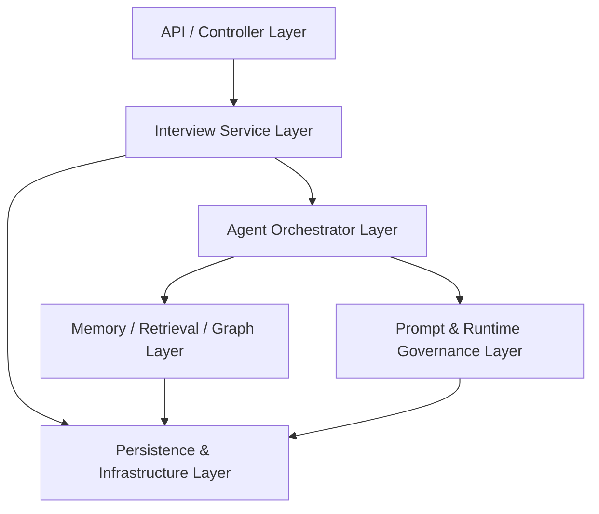

# 面试模块整体设计总计划文档

## 1. 文档定位

本文档不是单纯的目录页，而是 `AgentCareer` 项目中**面试模块的总体产品设计与技术架构总计划**。它用于回答三个核心问题：

- 这个面试模块为什么要做
- 它从产品到架构的整体设计边界是什么
- 各阶段版本演进分别承担什么建设任务

因此，本文档既承担总览作用，也承担“项目总设计说明书”的作用。后续的 `V1` 到 `V5` 文档，则是这份总计划在不同阶段的分版本落地记录。

## 2. 项目背景与建设动机

`AgentCareer` 的核心目标不是做一个泛化聊天机器人，而是构建一个面向求职训练场景的智能面试系统。它需要同时满足以下几个要求：

- 能围绕岗位和技术主题持续发起高质量追问
- 能结合候选人简历、项目经历和历史表现做针对性判断
- 能在多轮面试中保持上下文连续性，而不是每轮都像重新开场
- 能输出对后续复盘、学习规划和成长分析有价值的结构化结果

传统在线刷题系统的问题在于：

- 题目是静态的，无法按用户表现动态调整
- 无法利用用户真实项目经历进行深挖
- 面试过程和后续成长链路割裂

普通 LLM 聊天式问答也存在明显不足：

- 问题不够像真实面试
- 多轮状态容易漂移
- 无法稳定利用长期记忆和检索上下文
- 出错后缺少可解释性和可治理性

因此，这个模块从一开始就不是“套个模型接口”，而是一个需要持续演进的产品与架构工程。

## 3. 产品定义

### 3.1 产品一句话定义

一个围绕技术求职训练场景构建的 AI 面试引擎，能够结合用户背景、历史表现与知识结构，动态生成、追问、评分并沉淀可复用的成长信息。

### 3.2 目标用户

- 求职中的技术候选人
- 需要长期复盘和补短板的学习型用户
- 希望围绕目标岗位做模拟面试训练的用户

### 3.3 核心价值

- 从“做题”升级为“面试式训练”
- 从“单轮问答”升级为“连续成长档案”
- 从“泛化回复”升级为“结合背景的个性化追问”
- 从“模型黑盒”升级为“可记录、可解释、可演进的系统能力”

## 4. 业务需求总览

### 4.1 核心业务目标

面试模块需要完成以下闭环：

1. 用户发起一场面试
2. 系统基于岗位、主题、简历背景生成问题
3. 用户作答后，系统判断质量并决定追问或切题
4. 系统持续利用历史记忆、检索结果和知识结构优化提问
5. 面试结束后，沉淀结构化结果，服务后续复盘与成长

### 4.2 关键功能需求

- 面试会话管理
- 多轮消息持久化
- 首题生成与后续追问
- 用户画像与简历信息融合
- 短期、中期、长期记忆管理
- 检索增强与 GraphRAG 支持
- 多 Agent 决策
- PromptRuntime 与阶段级治理

### 4.3 非功能性需求

- 支持流式输出，避免长时间等待无反馈
- 模型失败时具备基础回退能力
- 面试主链路具备可追踪、可恢复、可定位的问题排查能力
- 架构允许在后续版本逐步增强，而不是一次性设计到终态

## 5. 范围定义

### 5.1 本模块当前负责什么

- 技术面试问答主链路
- 问题生成、追问、评分、难度控制
- 上下文拼装、检索、记忆调度
- 面试中间结果与后续知识沉淀的接口衔接

### 5.2 当前刻意不做什么

- 不把整个职业辅导平台所有能力都塞进面试主链路
- 不在早期版本做过度的微服务拆分
- 不把所有生成问题都交给一个超级 Prompt 统一处理
- 不在没有稳定主链路之前优先追求复杂运营后台

## 6. 总体架构定义

从当前项目演进轨迹来看，面试模块整体可以分成六层：

### 6.1 接口层

- `InterviewController`
- 面向前端暴露发起面试、回答问题、结束面试等能力

### 6.2 业务服务层

- `InterviewService`
- 负责面试状态流转、消息落库、限流、缓存和主链路调度

### 6.3 编排与决策层

- `AgentOrchestrator`
- 决策聚合、阶段调度、多 Agent 协作

### 6.4 认知增强层

- Memory：分层记忆与画像利用
- Retrieval：Hybrid RAG、HyDE、Rerank
- Graph：GraphRAG、知识关系与社区结构

### 6.5 Prompt 与运行治理层

- `PromptBuilder`
- `PromptBudgetAllocator`
- `PromptRuntimeTracker`
- `PipelineStageExecutor`

### 6.6 基础设施层

- MyBatis Plus
- MySQL / PostgreSQL
- Redis
- RabbitMQ
- LangChain4j 模型接入

## 7. 核心领域对象定义

当前面试模块围绕以下核心对象组织：

| 对象 | 作用 |
| --- | --- |
| `InterviewSession` | 表示一场完整面试 |
| `InterviewMessage` | 表示会话中的单条问答消息 |
| `UserProfile` | 表示用户背景、目标岗位、简历等长期信息 |
| `MemoryChunk` / `MemorySummaryMd` / `MemoryProfileJson` | 承载不同层级的长期与中期记忆 |
| `RetrievalPlanDTO` | 承载检索规划结果 |
| `FinalDecisionDTO` | 承载多 Agent 聚合后的下一步动作 |
| `PromptRuntimeMetrics` | 承载 Prompt 运行时观测指标 |

## 8. 核心技术路线与阶段性规划

这个模块不是一次性设计完成的，而是按问题驱动逐步演进。整体技术路线如下：

### 8.1 第一阶段：先跑通面试主链路

目标：

- 建立会话模型
- 建立流式问答主链路
- 完成基础 Agent 调用与消息持久化

对应文档：

- [V1.0-初始定义-跑通面试主链路.md](D:/java-project/AgentCareer/docs/interview-module-evolution/V1.0-初始定义-跑通面试主链路.md)

### 8.2 第二阶段：解决输入理解和系统遗忘

目标：

- 引入 Rewrite / HyDE
- 建立三层记忆
- 打通画像与面试上下文

对应文档：

- [V2.0-输入理解与三层记忆.md](D:/java-project/AgentCareer/docs/interview-module-evolution/V2.0-输入理解与三层记忆.md)

### 8.3 第三阶段：解决复杂问题召回和推理不足

目标：

- 建立 Retrieval Planning
- 引入 Hybrid RAG
- 接入 GraphRAG

对应文档：

- [V3.0-检索规划与GraphRAG.md](D:/java-project/AgentCareer/docs/interview-module-evolution/V3.0-检索规划与GraphRAG.md)

### 8.4 第四阶段：从单 Agent 升级为专家协同决策

目标：

- 拆分问题生成、评分、追问、难度控制职责
- 建立多 Agent 聚合决策模式
- 让复杂面试判断不再依赖单一 Prompt

对应文档：

- [V4.0-多Agent专家决策模式.md](D:/java-project/AgentCareer/docs/interview-module-evolution/V4.0-多Agent专家决策模式.md)

### 8.5 第五阶段：治理复杂链路

目标：

- 引入 PromptRuntime
- 引入 Stage Runtime 与恢复策略
- 让复杂链路变得可观测、可定位、可恢复

对应文档：

- [V5.0-PromptRuntime与阶段治理.md](D:/java-project/AgentCareer/docs/interview-module-evolution/V5.0-PromptRuntime与阶段治理.md)

### 8.6 第六阶段：从会话驱动升级为事件驱动的双层调度

目标：

- 把输入从“用户打字”扩展为环境事件，并保证幂等与可回放
- 拆出 Router 层（只判归属、不挂执行工具）与 Worker 层（隔离上下文、挂工具执行）
- 用 Thread 订阅直通，降低中心节点的决策量与上下文重复读
- 引入 Watchdog 外部控制回路与可对照的调度评测

对应文档：

- [V6.0-Super-agent双层架构.md](D:/java-project/AgentCareer/docs/interview-module-evolution/V6.0-Super-agent双层架构.md)

## 9. 开发策略与工程原则

### 9.1 坚持渐进式演进，而不是一步到位

这个模块的演进逻辑非常明确：先解决“有没有”，再解决“准不准”，再解决“深不深”，最后解决“稳不稳”。这比一开始追求终极架构更符合真实工程节奏。

### 9.2 优先收敛主链路，再扩展外围能力

很多能力例如知识沉淀、成长建议、图谱分析都很重要，但它们都必须建立在主链路可运行、可复盘、可治理的前提上。

### 9.3 让 Prompt、检索和决策成为正式工程对象

这个项目的一个关键原则是：不把 Prompt、检索和 Agent 决策当成“不可描述的魔法逻辑”，而是逐步把它们纳入结构化对象和运行治理体系中。

### 9.4 在资源有限前提下做妥协

项目现阶段依然是典型的资源约束型工程，因此必须接受以下现实：

- 某些规则仍然偏启发式
- 某些能力先做单体内聚而不是服务拆分
- 某些治理能力先做轻量版而不是平台级系统

这不是设计不足，而是符合真实项目推进方式的工程妥协。

## 10. 当前文档结构说明

本目录下的文档分工如下：

- `README.md`：整体项目设计总计划文档
- `V1.0`：面试主链路从 0 到 1
- `V2.0`：输入理解与三层记忆
- `V3.0`：检索规划与 GraphRAG
- `V4.0`：多 Agent 专家决策
- `V5.0`：PromptRuntime 与阶段治理
- `V6.0`：从会话驱动到事件驱动的 Super-agent 双层架构

## 11. 下一阶段建议

如果继续演进下一版，比较合理的方向有三个：

- 建立更强的自动化评估体系，让多 Agent、检索和 Prompt 调优有统一标尺
- 推进策略配置化，减少角色协作和检索规划中的硬编码规则
- 逐步把治理数据从“可记录”升级为“可反馈”，形成半自动优化闭环

这也是面试模块从“工程可用”继续走向“产品成熟”的关键一步。
