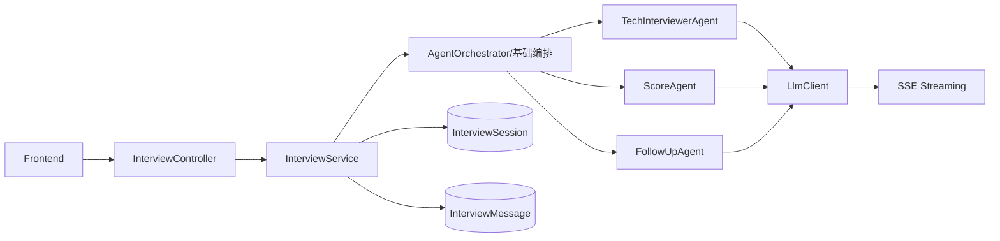

# V1.0 初始定义：跑通面试主链路

## 1. 解决了什么问题

V1 要解决的不是“面试系统够不够聪明”，而是更基础的问题：**项目里还没有一条稳定的面试主链路**。用户无法完成从“发起面试”到“收到问题、提交回答、获得下一轮反馈”的完整闭环，导致后续所有记忆、检索、图谱、评分优化都没有真实落点。

当时最关键的痛点有三个：

- 没有统一的面试会话模型，问题、回答、追问无法形成连续上下文
- LLM 调用散落在业务逻辑中，失败兜底和流式输出没有收口
- 产品侧需要尽快验证“AI 面试官”是否具备基本可用性，因此必须先把最短闭环做出来

一句话概括，V1 解决的是：**先让面试模块真正跑起来，而不是一开始就追求复杂增强。**

## 2. 版本定位

用最小可用方案完成“用户发起面试 -> AI 出题 -> 用户回答 -> AI 继续追问/下一题 -> 会话落库”的基础面试闭环。

## 3. 为什么当时这么做

### 3.1 业务背景

项目的目标不是普通聊天机器人，而是围绕求职者成长的技术面试系统。这个场景和通用问答不同，有两个鲜明特点：

- 对话是强目标导向的，系统必须持续围绕岗位、主题和用户薄弱点推进
- 面试内容天然具有状态性，同一轮问答必须挂靠在明确的 `InterviewSession` 之下

如果没有会话模型，后续的评分、追问、复盘、知识提炼都无从谈起。

### 3.2 首版策略

V1 明确采用 MVP 思路，只做以下最关键事情：

- 建立面试会话和消息存储模型
- 支持发起面试并生成首题
- 支持用户回答后继续生成追问或下一题
- 对模型失败提供基础兜底，避免接口直接崩溃
- 优先打通流式输出体验，避免前端长时间空白等待

这意味着很多看起来“更高级”的能力都被刻意延后，例如长期记忆、复杂检索规划、GraphRAG、多 Agent 决策治理。

## 4. 核心功能更新

### 4.1 面试会话模型落地

V1 形成了面试模块最基础的领域对象：

- `InterviewSession`
- `InterviewMessage`

它们让系统第一次具备了“以场次为单位组织面试”的能力。问题、回答、AI 回复不再是松散文本，而是可以挂到同一场会话下，便于后续做评分、追问和复盘。

### 4.2 主链路服务收口

在 [`InterviewService.java`](D:/java-project/AgentCareer/src/main/java/com/service/InterviewService.java) 中，V1 基本建立了两条核心链路：

- `startInterviewStream`：创建面试并生成第一题
- `answerQuestionStream`：保存用户回答并生成下一步回复

这一步把“业务动作”和“AI 调用动作”收到了统一服务里，虽然还不够优雅，但比把模型调用分散在 Controller 层要可控得多。

### 4.3 基础 Agent 角色抽象

V1 没有直接把所有逻辑塞进一个超长 Prompt，而是先抽象出几个最基础的角色接口：

- `TechInterviewerAgent`
- `FollowUpAgent`
- `ScoreAgent`

这为后续从“单体 Prompt”过渡到“多角色协作”埋下了接口基础。

### 4.4 LLM 调用封装与基础兜底

[`LlmClient.java`](D:/java-project/AgentCareer/src/main/java/com/ai/client/LlmClient.java) 在 V1 阶段承担了非常重要但容易被忽视的职责：

- 统一封装普通调用和流式调用
- 加入超时控制
- 加入有限重试
- 失败后使用 fallback 返回保底内容

这一步虽然简单，但它把“模型不稳定”从业务代码中抽离出来，避免面试链路一遇到异常就完全不可用。

## 5. 初步架构框架

### 模块划分

- 接口层：负责面试发起、答题、停止、结束
- 服务层：负责会话状态、消息写入、主链路编排
- Agent 层：负责问题生成、评分、追问等能力封装
- LLM Client 层：统一模型调用和异常兜底
- 持久化层：保存面试 session 与 message

## 6. 技术选型与权衡

| 维度 | 选择 | 为什么选 | 放弃了什么 |
| --- | --- | --- | --- |
| 后端框架 | Spring Boot 3 | 适合快速搭建 API、SSE、事务与依赖注入 | 没选 Quarkus/Micronaut，因为首版更看重团队熟悉度 |
| 数据访问 | MyBatis Plus | CRUD 开发成本低，适合中小规模领域模型快速落地 | 没选 JPA，原因是对 SQL 可控性要求更高 |
| 模型接入 | LangChain4j | 便于统一封装 Chat 模型与 Streaming 模型 | 没直接裸调 HTTP SDK，原因是流式和模型抽象复用成本更高 |
| 通信方式 | SSE | 面试问题生成是明显的渐进式反馈场景 | 没选 WebSocket，首版不需要双向长连接复杂度 |
| 数据库 | 关系型数据库 | `InterviewSession`/`InterviewMessage` 明显是强结构化事务数据 | 没选文档数据库，因为首版不需要弱结构灵活性 |

### 核心权衡

V1 最重要的架构取舍是：**不微服务化，不做超前拆分。**

原因很现实：

- 当时核心风险在“场景是否成立”，不是“服务是否可横向扩容”
- 单体应用更利于快速联调 Prompt、会话、落库、流式输出
- 过早拆分会让问题从“产品能力未验证”变成“分布式复杂度先失控”

## 7. MVP 范围界定

### 做什么

- 支持用户开启技术面试
- 支持 AI 生成首题和后续问题
- 支持保存完整问答消息
- 支持基础评分与追问分流
- 支持 SSE 流式返回

### 不做什么

- 不做长期记忆与画像融合
- 不做检索增强与图谱推理
- 不做复杂 Prompt 预算治理
- 不做异步后处理与知识沉淀自动化
- 不做阶段级恢复和运行时追踪

## 8. 深度决策复盘

### Why

V1 面临的核心问题不是准确率，而是**能力不存在**。如果没有一条面试主链路，团队根本无法判断：

- 用户是否愿意和 AI 面试官持续交互
- 面试消息怎样组织才适合后续追问和复盘
- 流式输出是否真能提升体验
- 评分和追问应该放在哪个链路节点

### What

V1 解决了三个基础痛点：

- 把“面试”从一次普通问答，变成了有状态的会话
- 把 AI 调用从零散逻辑收敛成相对统一的主链路
- 把失败兜底与流式输出纳入系统边界内，而不是留给前端兜底

### Trade-off

V1 的代价同样明显：

- Prompt 仍然偏粗糙，问题生成稳定性有限
- 上下文只依赖当前会话和少量显式参数，容易遗忘用户背景
- 评分、追问、出题之间的职责边界还不清晰
- 主链路依然偏同步串行，后续扩展空间有限

这是一个典型的资源有限场景下的务实选择：先把最小闭环做出来，再用真实链路暴露问题，而不是在纸面上追求完美架构。

## 9. 版本遗留问题

V1 跑通之后，暴露出的下一阶段问题已经很明确：

- 用户输入表达不稳定，系统容易理解偏差
- 多轮面试中上下文遗忘严重
- 对用户长期背景几乎没有利用
- 一旦问题复杂，系统只能靠当前 Prompt 硬撑

这些问题直接推动了 V2 的输入理解增强和三层记忆体系建设。
