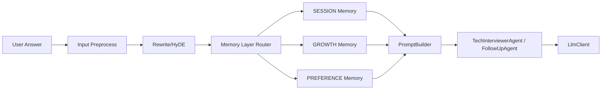

# V2.0 输入理解与三层记忆：解决答非所问与上下文遗忘

## 1. 解决了什么问题

V2 的核心目标非常明确：**解决 V1 阶段“问不准、记不住”的问题。**

V1 虽然已经跑通了主链路，但一进入真实面试场景，很快暴露出两类高频故障：

- 用户输入很口语化、跳跃化，模型容易直接按表面文字作答，导致答非所问
- 多轮面试只依赖短对话上下文，系统会忘记用户简历背景、前几轮表现和历史薄弱点

因此，V2 不是简单加功能，而是第一次系统性地回答两个问题：

- 用户真正想问什么
- 系统应该记住什么，并在什么时候取出来

一句话概括，V2 解决的是：**让面试从“能聊”升级为“能持续聊对”。**

## 2. 版本定位

通过输入重写、HyDE 扩展、三层记忆和画像融合，提升面试系统对用户意图和上下文的理解能力。

## 3. 为什么当时必须这么改

### 3.1 V1 暴露出的真实问题

在面试场景中，用户输入往往不是规范问题，而是下面这种形式：

- “这个我不太会，要不你再从项目里问我一下”
- “刚刚那个 Redis 问题，如果换成高并发怎么办”
- “我之前简历里写过缓存雪崩，你可以继续深挖”

这类输入对系统提出了两个要求：

- 要理解省略、代词、上下文依赖
- 要把当前问题和用户长期背景联系起来

V1 的单层上下文做不到这一点，因此系统经常出现表面看“回答了”，本质上却偏题的情况。

### 3.2 版本目标

V2 的目标不是追求更复杂的推理，而是先让上下文利用真正变得有层次。为此，这个版本拆成两个主攻方向：

- 输入侧增强：先把 query 变得更适合模型理解与检索
- 记忆侧增强：把用户信息从单一上下文扩展成可分层使用的记忆体系

## 4. 核心功能更新

### 4.1 输入理解增强：Rewrite 与 HyDE

V2 在用户输入进入主链路前，开始加入预处理能力，目的不是替代用户表达，而是让系统更容易抓到真实意图。

关键能力包括：

- Query Rewrite：将口语化、碎片化表达整理成更明确的问题
- HyDE 扩展：为向量检索生成一段“假设性相关说明文本”，提高相关概念覆盖率
- 歧义消解：尽量把“这个”“刚才那个”“上一个问题”指向具体语义对象

在代码层面，[`HydeQueryExpansionService.java`](D:/java-project/AgentCareer/src/main/java/com/ai/rag/HydeQueryExpansionService.java) 已经体现出这类设计思路：它不是直接回答用户，而是生成帮助召回的技术说明文本，并带有缓存和失败回退。

### 4.2 三层记忆体系

V2 逐步引入分层记忆思想，把“系统记忆”拆成不同职责：

- `SESSION`：当前会话短期上下文，适合承接当前题目的追问
- `GROWTH`：历史表现、薄弱点、复习轨迹，适合长期成长分析
- `PREFERENCE`：目标岗位、技术方向、简历信息、用户偏好

在代码层面，这种分层已经体现在 [`MemoryLayerRouterService.java`](D:/java-project/AgentCareer/src/main/java/com/ai/memory/MemoryLayerRouterService.java) 中。它会根据 query 类型和上下文依赖程度，判断优先命中哪一层记忆，而不是一股脑把所有内容塞进 Prompt。

### 4.3 用户画像与长期信息融合

V2 进一步把面试链路和用户画像打通，使以下信息可以进入 Prompt：

- 简历文本
- 项目经历摘要
- 目标岗位
- 历史总结和 profile JSON

这一步很关键，因为面试问题的质量本质上取决于“考什么人、围绕什么经历、为什么这么问”。如果没有画像融合，系统只能问出泛化技术题，难以形成真正的面试感。

### 4.4 Prompt 结构化升级

[`PromptBuilder.java`](D:/java-project/AgentCareer/src/main/java/com/ai/prompt/PromptBuilder.java) 在这一阶段开始承担更核心的职责：

- 统一拼接用户画像
- 拼接长期总结
- 拼接 RAG 召回内容
- 拼接近期上下文
- 明确当前任务与输出规则

这标志着系统开始从“业务代码里手拼 Prompt”转向“Prompt 作为正式工程对象被管理”。

## 5. 架构与技术调整

### 关键变化

- 输入在进入主 Agent 前不再直接裸奔，而是先进行增强
- 记忆不再是单一来源，而是按层分类、按需路由
- PromptBuilder 从“模板工具”升级为“上下文组装器”
- 用户画像首次和面试问题生成链路发生稳定耦合

## 6. 深度决策复盘

### Why

V2 要解决的不是模型能力上限，而是系统在真实输入面前的脆弱性：

- 用户说得不清楚，系统就容易偏题
- 用户说得很清楚，但系统记不住前文和长期背景
- 用户同一个主题反复练习，系统却把每次对话都当成全新会话

如果不先解决这些问题，继续叠加检索、图谱、多 Agent 只会把错误放大。

### What

V2 带来的核心收益是：

- 输入更适合模型和检索系统理解，减少答非所问
- 上下文利用开始分层，避免所有信息都挤在同一段 Prompt 里
- 面试问题开始真正围绕用户背景和长期薄弱点展开
- 系统第一次具备“记住用户”的雏形，而不只是“记住上一轮消息”

### Trade-off

V2 引入的复杂度也不小：

- Rewrite 可能把原始意图改坏，因此必须保留原始 query 作为回退依据
- HyDE 会提升召回覆盖率，但也可能把不相关概念一起放大
- 记忆层数一多，噪声管理就成了新问题
- Prompt 上下文变丰富之后，Token 消耗也开始变成显性成本

这也是为什么 V2 虽然提升了“记得住、问得准”的能力，但同时埋下了新的技术债：系统开始需要更精细的检索规划和预算治理。

## 7. 技术选型与工程取舍

| 能力 | 选择 | 原因 | 代价 |
| --- | --- | --- | --- |
| 输入增强 | Rewrite + HyDE | 同时兼顾语义清洗与召回扩展 | 链路变长，调试难度增加 |
| 记忆分层 | Session/Growth/Preference | 贴合面试场景的时间跨度和用途差异 | 路由逻辑需要持续维护 |
| 缓存 | 查询级缓存 | 降低重复 HyDE 生成和重复召回成本 | 需要处理过期与脏数据 |
| Prompt 统一构建 | PromptBuilder | 降低手工拼装失控风险 | Prompt 模板本身需要版本管理 |

## 8. 版本遗留问题

V2 虽然解决了输入理解和记忆利用问题，但新的瓶颈已经出现：

- 记忆增强仍然不等于复杂知识推理
- 遇到比较型、系统设计型、跨项目关联型问题时，单靠记忆和简单双向量召回仍然不够
- 检索内容越来越多，如果没有预算与优先级管理，Prompt 会继续膨胀

这些问题直接推动了 V3 的检索规划、Hybrid RAG 和 GraphRAG 演进。
