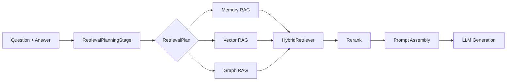

# V3.0 检索规划与 GraphRAG：解决复杂问题召回不足

## 1. 解决了什么问题

V3 要解决的问题是：**V2 虽然已经能理解输入、利用记忆，但在复杂问题上仍然“知道得不够深、连得不够全、取舍得不够稳”。**

具体表现为：

- 复杂技术问题需要跨多段历史信息、简历经历、知识点关系做综合判断，单一记忆召回不够
- 一旦把更多内容硬塞进 Prompt，就会出现上下文污染，反而降低回复质量
- 不同问题明明需要不同检索策略，但系统之前缺少统一的检索规划层

因此，V3 的本质不是单纯加一个 RAG，而是把“检索什么、检索多少、检索哪一层、是否需要图谱推理”从隐式经验，升级成显式决策。

一句话概括，V3 解决的是：**让系统在复杂问题下不只是记得住，而且能更有依据地召回和推理。**

## 2. 版本定位

通过 Retrieval Planning、Hybrid RAG 和 GraphRAG，把面试模块从“上下文驱动”升级为“检索规划驱动”。

## 3. 为什么当时必须这么改

### 3.1 V2 的上限

V2 能处理很多中轻度面试场景，但一旦进入下面这些问题，系统就容易失真：

- 基于项目经历继续深挖某个技术选型
- 对两个知识点做比较、迁移和取舍
- 根据长期薄弱点设计下一轮追问
- 从历史表现中识别“概念会背，但场景落地弱”

这类问题有一个共同特征：需要**多来源、多粒度、带关系的上下文**。仅靠单层记忆或普通向量召回，很难保证质量。

### 3.2 架构问题开始显性化

到了这个阶段，问题已经不再是“有没有内容”，而是“内容该怎么选”。如果没有一个规划层，系统会陷入两个极端：

- 要么召回过少，答得浅
- 要么召回过多，Prompt 被污染

所以 V3 必须新增一个中间层，专门负责检索决策。

## 4. 核心功能更新

### 4.1 Retrieval Planning：先决定怎么检索，再决定怎么回答

[`RetrievalPlanningStage.java`](D:/java-project/AgentCareer/src/main/java/com/ai/orchestrator/pipeline/RetrievalPlanningStage.java) 代表了 V3 的关键思想：把检索从隐式行为变成显式阶段。

这个阶段负责做几件事：

- 判断当前问题是否应该跳过重检索
- 判断是轻量召回还是完整召回
- 生成 `RetrievalPlanDTO`
- 应用 memory governance，决定优先命中的记忆层和存储类型

这一步极大改变了系统行为。以前是“想到什么就查什么”，现在是“先规划，再执行”。

### 4.2 Hybrid RAG：多种检索能力组合，而不是单一路径

[`HybridRetriever.java`](D:/java-project/AgentCareer/src/main/java/com/ai/rag/HybridRetriever.java) 在 V3 中成为真正的检索枢纽。它把三类检索能力统一起来：

- Memory RAG：召回用户画像、历史总结、会话记忆
- Vector RAG：召回通用技术知识
- Graph RAG：召回关系型、多跳型、主题聚合型上下文

同时它还具备几个工程上很关键的特性：

- 支持 HyDE 扩展后的 vector query
- 支持主检索器和辅助检索器组合
- 支持 keyword fallback
- 支持统一 rerank
- 支持 retrieval budget 控制

这说明 V3 并不是简单“加 RAG”，而是开始对召回链路做组合治理。

### 4.3 GraphRAG：从文本片段召回升级为关系型上下文召回

V3 引入了完整的 GraphRAG 相关对象和服务：

- `GraphRagRetriever`
- `GraphRagQueryClassifier`
- `GraphRagRetrievalRouter`
- `GraphRagLocalSearchStrategy`
- `GraphRagGlobalSearchStrategy`
- `GraphRagDriftSearchStrategy`
- `GraphCommunityService`
- `GraphRagIndexerService`

这套能力的目的，是解决普通文本召回很难处理的两个问题：

- 跨片段关系弱，难以形成“为什么要继续追问这个主题”的推理依据
- 候选人的知识结构、项目经验和薄弱点分散在不同文本块中，难以聚合成一个面试判断

GraphRAG 通过实体、关系、社区等抽象，让系统可以围绕“知识结构”而不是单条文本进行检索。

### 4.4 Prompt Budget 与检索预算开始进入正式治理

随着召回能力变强，另一个问题马上出现：上下文会持续膨胀。

因此 V3 开始正式引入两类预算概念：

- 检索预算：限制 retriever 调用次数、chunk 消耗
- Prompt 预算：限制塞入上下文的内容量

如果没有预算治理，GraphRAG 和 Hybrid RAG 只会把系统带向“理论更聪明，实际更不稳定”。

## 5. 架构与技术调整

### 本阶段核心调整

- 在生成回复前增加独立的检索规划阶段
- 用统一 `RetrievalPlanDTO` 承载检索决策
- 建立 HybridRetriever 作为多源召回聚合器
- 把 GraphRAG 从试验性质能力升级为正式接入链路的模块
- 通过 budget 限制检索和上下文膨胀

## 6. 深度决策复盘

### Why

V3 的根因是：V2 已经把“怎么记”做得差不多了，但“怎么找、怎么选、怎么串起来”仍然是弱项。

面对复杂面试问题时，系统需要的不只是更多上下文，而是更**有结构的上下文选择**。如果没有这一步，系统会越来越像一个把所有材料堆给模型的管道，而不是一个真正会做决策的面试引擎。

### What

V3 解决了几个非常关键的问题：

- 让检索行为从“默认全开”变成“按问题类型决定”
- 让召回来源从单一记忆，扩展为记忆、向量、图谱协同
- 让复杂问题拥有更强的关系依据和追问依据
- 让上下文不再只是越多越好，而是开始按预算和优先级分配

### Trade-off

V3 带来的新复杂度也非常现实：

- 检索链路更长，时延更高
- GraphRAG 的实体抽取和关系抽取噪声会直接影响后续检索质量
- rerank 能提升相关性，但也会增加额外调用成本
- 检索策略一旦增多，系统行为就更难靠直觉理解

这就是为什么 V3 虽然显著提升了复杂问题能力，但同时也把系统推向了新的瓶颈：**链路越来越复杂，出了问题却很难知道卡在哪一层。**

## 7. 技术选型与权衡

| 能力 | 选择 | 为什么选 | 放弃或延后 |
| --- | --- | --- | --- |
| 检索规划 | 单独 Stage 化 | 让检索决策可记录、可回退 | 没继续维持“业务代码里顺手判断” |
| 多源召回 | HybridRetriever | 统一不同召回器的组合逻辑 | 没把三种召回拆成互相独立的上层编排 |
| 图谱模式 | Local/Global/Drift | 匹配不同问题的推理深度 | 没采用单一图检索入口，避免粗暴一刀切 |
| 预算治理 | RetrievalBudget + PromptBudget | 控制复杂链路成本和时延 | 没放任召回链路无限扩张 |

## 8. 版本遗留问题

V3 结束后，模块能力明显更强，但系统治理问题也彻底暴露出来：

- 多个阶段串联后，失败点增多
- 很多问题已经不是“回答错了”，而是“不知道到底是规划错、召回错、拼 Prompt 错，还是生成错”
- 流式输出、回退策略、失败恢复和 trace 还没有统一抽象

这些问题直接推动了 V4 的多智能体编排、PromptRuntime 和阶段运行时治理。
