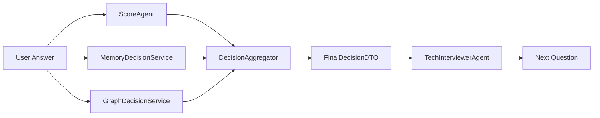

# V4.0 多 Agent 专家决策：解决单 Agent 职责过载

## 1. 解决了什么问题

V4 要解决的问题是：**当检索、记忆、图谱能力逐步接入后，单一 Agent 已经无法同时稳定承担“提问、评分、判断、追问、难度控制”这些职责。**

在单 Agent 模式下，系统会持续出现几类问题：

- 一个 Prompt 同时承担太多目标，导致模型输出容易摇摆
- 问题生成、评分判断、追问策略彼此耦合，某一处改 Prompt 容易牵一发而动全身
- 面对复杂回答时，系统缺少“多个专家视角共同判断”的机制，只能依赖单次生成结果
- 随着检索上下文变复杂，单 Agent 更容易出现角色漂移，既想当面试官，又想当评分官，还想兼任成长顾问

一句话概括，V4 解决的是：**把单一 AI 面试官升级为“专家研讨式”的多 Agent 决策系统，让复杂判断不再压在一个 Prompt 上。**

## 2. 版本定位

将面试主链路从“单 Agent 串行生成”升级为“多 Agent 分工判断 + 聚合决策”，让系统具备更稳定的提问和追问能力。

## 3. 为什么当时必须这么改

### 3.1 单 Agent 的上限已经到了

在 V3 阶段，系统已经能拿到更多上下文，但这反而把单 Agent 的短板放大了。因为上下文越多，职责越多，一个 Prompt 就越难稳定满足所有目标：

- 既要理解用户这一轮答得好不好
- 又要判断应该追问还是切下一题
- 还要识别应该围绕哪个薄弱点深挖
- 最后还要生成自然、真实、像面试官的话术

这种设计在简单链路里还能工作，但进入复杂面试后，很容易出现“评分像建议、追问像总结、问题像闲聊”的角色错位。

### 3.2 真实面试本来就不是单一视角

真实企业面试很少是纯粹单脑决策。通常至少会有几类隐含角色：

- 有人负责判断回答质量
- 有人负责决定是否继续深挖
- 有人负责控制难度节奏
- 有人负责把问题措辞得更像真实面试官

因此，多 Agent 并不是为了“炫技”，而是为了让系统结构更接近真实决策过程。

## 4. 核心功能更新

### 4.1 专家角色拆分

这一版本开始把原来堆叠在单 Agent 中的职责拆开，形成更明确的角色分工：

- `ScoreAgent`：负责判断用户回答质量，输出结构化评分结果
- `FollowUpAgent`：负责判断是否需要继续追问、应该往哪个薄弱点深挖
- `TechInterviewerAgent`：负责最终生成面试官问题
- 决策服务：负责从不同判断信号中产出统一行动

这样做之后，每个 Agent 的 Prompt 目标更加单一，输出也更容易约束。

### 4.2 决策中枢引入

[`AgentOrchestrator.java`](D:/java-project/AgentCareer/src/main/java/com/ai/orchestrator/AgentOrchestrator.java) 在这个阶段不再只是“帮忙串一下调用”，而是正式成为多 Agent 决策中枢。

它承担了几个关键职责：

- 接收当前问题、用户回答、画像信息和检索上下文
- 调用评分、追问、决策相关模块
- 汇总多个 Agent 或多个决策服务的结果
- 输出统一的下一步动作，例如 `FOLLOW_UP`、`NEXT`

这意味着系统第一次拥有了“内部研讨、外部给结论”的形态。

### 4.3 决策聚合机制

多 Agent 的价值不只在“拆角色”，还在“怎么合结果”。这一版本开始引入：

- `DecisionAggregator`
- `MemoryDecisionService`
- `GraphDecisionService`
- `DifficultyPolicy`

它们共同构成了一个更接近专家会诊的判断框架：

- 评分信号判断答得怎么样
- 记忆信号判断用户长期薄弱点和值得继续深挖的方向
- 图谱信号判断知识关联和延展路径
- 难度策略控制下一题是继续加压还是切换节奏

最终系统不是简单取某一个 Agent 的输出，而是做一次聚合决策。

### 4.4 从单次生成改为“决策 + 生成”两段式链路

V4 之前，系统更像是“拿到上下文后直接生成下一句”。到了这一版，链路被拆成两段：

1. 先做内部决策
2. 再按决策结果生成面试问题

这一步非常重要，因为它把“想清楚做什么”和“把话说出来”分开了。前者更偏策略，后者更偏语言生成，两者不再强行绑在同一个 Prompt 中。

## 5. 架构与技术调整

### 核心架构变化

- 从“单 Agent 直接回答”改为“多信号决策后再生成”
- 引入统一聚合层，而不是让多个 Agent 彼此直接耦合
- 决策结果结构化，便于后续接入运行时治理与 trace
- 难度控制、追问判断和问题生成逐步解耦

## 6. 深度决策复盘

### Why

这一版的根因是：**系统变复杂后，单 Agent 已经不是智能不够，而是职责设计不合理。**

如果继续把所有能力叠加进一个 Prompt，会出现两个必然后果：

- Prompt 越写越长，但边界越来越模糊
- 输出看似完整，实际上难以稳定复现

多 Agent 本质上是一次职责再分配，而不是单纯增加调用次数。

### What

V4 带来了几个很直接的收益：

- 评分、追问、提问生成不再互相争抢 Prompt 空间
- 复杂问题下的下一步动作更稳定，不容易随机漂移
- 系统开始拥有“专家视角协商后再出题”的能力
- 后续如果要优化某一类判断，只需要调整对应 Agent 或决策服务，而不必重写整条链路

### Trade-off

多 Agent 并不是免费午餐，它显著增加了新的复杂度：

- 调用链更长，整体时延上升
- 不同 Agent 输出格式必须更严格，否则聚合层容易失效
- 多角色之间可能出现判断冲突，需要明确优先级和兜底策略
- 调试成本明显上升，因为问题不再只属于一个 Prompt

为了控制这些风险，这一版采取了几个务实策略：

- 先保留较少的核心 Agent，不盲目扩展角色数量
- 决策结果统一收敛到结构化 DTO，而不是让下游直接消费自然语言
- 聚合层优先做保守判断，避免因为某个 Agent 波动导致整条面试节奏失控

## 7. 技术选型与工程取舍

| 能力 | 选择 | 为什么选 | 妥协点 |
| --- | --- | --- | --- |
| 角色拆分 | 专家式多 Agent | 贴近真实面试决策过程 | 调用次数增加 |
| 聚合方式 | `DecisionAggregator` | 统一吸收多方判断，避免散落 if/else | 需要额外定义决策协议 |
| 难度控制 | `DifficultyPolicy` | 让追问和升降难度有规则可依 | 早期规则仍偏启发式 |
| 决策信号 | 评分 + 记忆 + 图谱 | 兼顾当前表现和长期背景 | 信号冲突需要后续治理 |

## 8. 版本遗留问题

多 Agent 决策把“角色过载”问题拆开了，但也带来了新的工程议题：

- 阶段越来越多，失败点更分散
- 系统需要知道每个阶段到底输入了什么、做了什么、失败在哪
- Prompt 长度和 Token 消耗越来越不可忽视
- 多 Agent 的输出如果没有统一运行时跟踪，排障依然困难

这些问题直接推动了下一版本的 PromptRuntime、Stage Runtime 和恢复治理建设。
