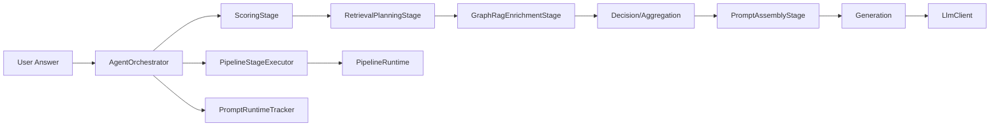

# V5.0 PromptRuntime 与阶段治理：解决复杂链路失控

## 1. 解决了什么问题

V5 要解决的问题，不再是单点能力不足，而是**系统在能力变复杂之后开始失控**。

到 V4 为止，面试模块已经具备了多 Agent 决策、记忆、检索、GraphRAG 等增强能力，但很快出现了新的现实问题：

- 一个请求内部有多个阶段，出了问题很难知道是哪一步失败
- Prompt 越来越长，但团队对“到底塞了多少上下文、压缩了多少、消耗了多少 Token”缺乏显性认知
- 检索、评分、图谱增强、回复生成任何一个环节失败，都可能把整条链路拖垮
- 多 Agent 编排已经成型，但如果没有统一运行时，复杂链路依然像黑盒

因此，V5 的重点不再是继续堆能力，而是把已有能力纳入可控边界。

一句话概括，V5 解决的是：**让面试系统不仅更聪明，而且更可诊断、可恢复、可治理。**

## 2. 版本定位

在多 Agent 专家决策已经成型的基础上，引入 PromptRuntime、阶段运行时和统一回退策略，把复杂面试链路升级为可治理的推理流水线。

## 3. 为什么当时必须这么改

### 3.1 能力越强，黑盒越大

V4 之后，系统已经不是一次简单的 LLM 调用，而是一条包含多个阶段的复杂链路：

- 评分
- 检索规划
- GraphRAG 增强
- 决策聚合
- Prompt 组装
- 最终生成

如果这些阶段没有统一运行模型，系统就会出现典型问题：

- 成功时不知道为什么成功
- 失败时不知道失败在哪
- 回退时不知道回退是否真的生效

### 3.2 Prompt 已经成为第一类运行时对象

到了这个阶段，Prompt 不再只是模板文本，而是系统行为的重要载体。团队必须知道：

- 原始上下文有多大
- 压缩后上下文有多大
- 哪些地方触发了 fallback
- 哪次请求的 token 开销异常

这正是 PromptRuntime 被正式纳入版本核心的原因。

## 4. 核心功能更新

### 4.1 沿用多 Agent 编排结果，转向运行时治理

[`AgentOrchestrator.java`](D:/java-project/AgentCareer/src/main/java/com/ai/orchestrator/AgentOrchestrator.java) 在这一版的价值，主要体现在它成为运行时治理的总入口，而不是单纯的角色组织器。

系统在这里统一驱动：

- 各阶段执行顺序
- 各阶段回退策略
- PromptRuntime 生命周期
- Trace 和运行状态汇总

这意味着系统终于从“多个能力勉强串起来”进化为“有治理边界的流水线”。

### 4.2 Stage 化运行时：把链路变成可以管理的流水线

[`PipelineStageExecutor.java`](D:/java-project/AgentCareer/src/main/java/com/ai/orchestrator/runtime/PipelineStageExecutor.java) 标志着系统从“方法顺序调用”进入“阶段执行模型”。

每个阶段现在具备了明确属性：

- 当前状态
- 开始和结束时间
- 是否成功
- 是否触发恢复
- 使用了什么恢复动作

这一步非常关键，因为它让链路具备了运行时可解释性。系统第一次能系统化回答“这次请求到底卡在哪一步”。

### 4.3 PromptRuntime：把 Prompt 黑盒变成可观测对象

[`PromptRuntimeTracker.java`](D:/java-project/AgentCareer/src/main/java/com/ai/runtime/PromptRuntimeTracker.java) 是 V5 最有工程价值的增强之一。

它记录的不是单纯的日志，而是和 Prompt 直接相关的运行时指标，例如：

- 原始上下文字符数与压缩后字符数
- 估算 token 数
- token 节省量
- LLM 调用次数
- 重试次数
- fallback 是否触发
- 最终是否成功产出回复

这让团队第一次可以基于事实而不是感觉去讨论 Prompt 问题。例如：

- 是不是上下文过长导致模型质量波动
- 是不是 fallback 触发太频繁
- 是不是压缩策略过于激进

### 4.4 Prompt Budget 正式进入主链路治理

V3 已经有 Prompt 预算概念，但到了 V5，这个能力真正被纳入编排主流程。在 `generateFirstQuestionStream` 等链路里，`PromptBudgetAllocator` 已经被直接用于压缩上下文并记录运行信息。

这意味着系统从“知道 Prompt 太长可能有问题”，进化为“主动控制 Prompt 长度并留下证据”。

### 4.5 失败恢复、限流、缓存与守卫机制补齐

V5 进一步补上了复杂链路必须具备的稳定性组件：

- `AiRateLimitService`
- `AiQueryCacheService`
- `InterviewMemoryCacheService`
- `GuardService`
- `StageRecoveryPolicy`
- `StageRecoveryResult`

这些能力本身不直接提升“回答更聪明”，但它们决定了系统能否在复杂条件下继续提供稳定体验。

## 5. 架构与技术调整

### 本阶段的核心结构变化

- 面试主链路正式阶段化
- 每个阶段都可被 trace、可回退、可统计
- Prompt 进入运行时治理范围
- 多 Agent 成果被纳入统一治理框架
- 缓存、限流、守卫和 fallback 形成完整兜底体系

## 6. 深度决策复盘

### Why

V5 的驱动力不是“能力不够”，而是“复杂度已经超过人脑直接掌控的阈值”。如果没有运行时治理，后续继续加能力会带来三个结果：

- 问题越来越难复现
- 质量越来越难解释
- 代码越来越像一团只能工作的黑箱

所以 V5 的本质，是把系统从“实验型 AI 功能堆叠”拉回“工程化可维护系统”。

### What

V5 解决了几个很关键的工程痛点：

- 把复杂链路拆成可观测的阶段
- 把 Prompt 从文本拼接物升级成可治理对象
- 把失败从“整条链路挂掉”变成“局部回退后继续完成”
- 让多 Agent 链路终于有统一的运行时外壳

它带来的最大收益不只是稳定性提升，而是团队终于能看清系统到底在做什么。

### Trade-off

V5 也明确引入了新的代价：

- 埋点、状态机、回退策略会增加代码量和理解门槛
- 运行时治理一旦设计过重，容易反向侵入业务逻辑
- 多 Agent 编排会带来更多上下文传递和阶段协调成本
- 如果没有良好的 trace 展示层，记录再多数据也可能难以消费

因此，这一版的原则不是“治理越多越好”，而是“只治理真正影响主链路判断和排障效率的部分”。

## 7. 技术选型与权衡

| 能力 | 选择 | 为什么选 | 风险 |
| --- | --- | --- | --- |
| 编排方式 | 自研 `AgentOrchestrator` + Stage | 更贴合现有 Java/Spring 代码结构 | 需要自己维护边界和约束 |
| Runtime 记录 | ThreadLocal + Context 模式 | 对现有业务接口侵入较小 | 异步扩散场景下需谨慎处理上下文 |
| 恢复策略 | Stage 级 Recovery | 避免单点失败导致整链路崩溃 | 回退逻辑本身会增加测试复杂度 |
| Prompt 治理 | PromptRuntime + BudgetAllocator | 让上下文成本可见、可控 | 指标多了以后需要防止噪声过载 |

## 8. 版本遗留问题

V5 并不代表终点，它留下的下一阶段议题也很清晰：

- 多 Agent 的协作策略仍然偏代码硬编码，配置化程度不够
- PromptRuntime 目前更偏观测，还没有形成自动调优闭环
- GraphRAG、记忆路由、决策聚合之间仍可能存在重复判断
- 治理层已经成型，下一步更适合补评估体系和策略配置中心

这意味着如果未来继续演进，V6 更可能关注“策略平台化、评估自动化和配置解耦”，而不是继续无节制叠加新能力。
